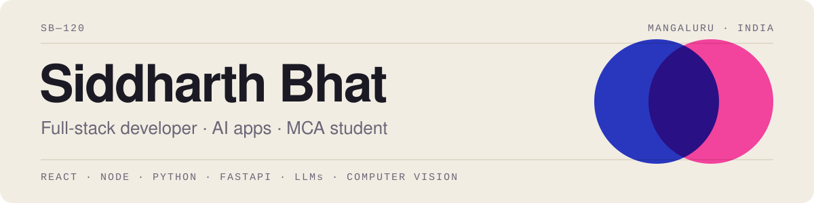

<picture>
  <source media="(prefers-color-scheme: dark)" srcset="assets/banner-dark.svg">
  
</picture>

### I build complete web and mobile apps, from the database to the screen.

I'm an MCA student at AIMIT, St Aloysius (Deemed to be University), Mangaluru. Most of my work is full-stack JavaScript, with Android and machine-learning projects alongside. I'm looking for an **internship or fresher role in software development**.

[Portfolio](https://siddharthbhat120.github.io) · [LinkedIn](https://linkedin.com/in/siddharthxcoder) · [Resume (PDF)](https://siddharthbhat120.github.io/assets/Siddharth-Bhat-Resume.pdf) · [HackerRank](https://www.hackerrank.com/profile/pbhat554)

## Selected projects

| Project | What it does | Built with |
|---|---|---|
| [**TaskFlow**](https://github.com/SiddharthBhat120/TaskFlow) | Project and team management: Kanban board, real-time chat and notifications, role-based access, reports | Angular, Node.js, Express, MongoDB, Socket.IO |
| [**PixelStore**](https://github.com/SiddharthBhat120/PixelStore) | Online store for PC games and gear: cart, checkout, order tracking, reviews, admin dashboard | React, Node.js, Express, MongoDB, JWT |
| [**Habit Tracker**](https://github.com/SiddharthBhat120/HabitTracker) | Android app for daily habits, streaks and a mood journal (team of two) | Kotlin, Jetpack Compose, Firebase |
| [**Qualify Milk**](https://github.com/SiddharthBhat120/Qualify-Milk) | Predicts milk quality from seven lab readings. Compares ten models and reports honestly on a dataset where most rows are duplicates | Python, scikit-learn, Flask |
| [**CrowdMate**](https://github.com/SiddharthBhat120/CrowdMate) | One QR code for crowded places: live virtual queues and lost-person safety tags, works offline | React, TypeScript, Node.js |
| [**PotSpot**](https://github.com/SiddharthBhat120/POTSPOT) | Turns dashcam video into a map of potholes ([live demo](https://siddharthbhat120.github.io/POTSPOT/)) | Python, YOLO11, FastAPI, React, Leaflet |

More on the [repositories tab](https://github.com/SiddharthBhat120?tab=repositories), including [Beam Share](https://github.com/SiddharthBhat120/beam_share) (offline file transfer in Flutter) and [Paroh](https://github.com/SiddharthBhat120/paroh-twin), a hackathon team project where I worked on the front end.

## What I work with

**Most often:** JavaScript, React, Node.js, Express, MongoDB, Python, Kotlin (Android)

**Also used in projects:** Angular, TypeScript, Flask, FastAPI, scikit-learn, Socket.IO, Bootstrap, MySQL, SQLite, Flutter

**Tools:** Git and GitHub, Jupyter Notebook, Power BI, Docker, GitHub Actions

## Right now

- Finishing my MCA and applying for internships and fresher roles
- Going deeper into machine learning and data science
- Adding tests and live demos to the projects above

## Contact

The fastest way to reach me is [LinkedIn](https://linkedin.com/in/siddharthxcoder) or email: **pbhat554@gmail.com**
